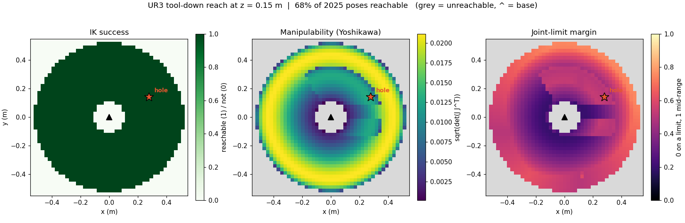
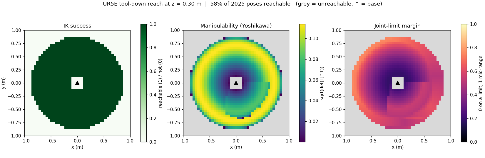
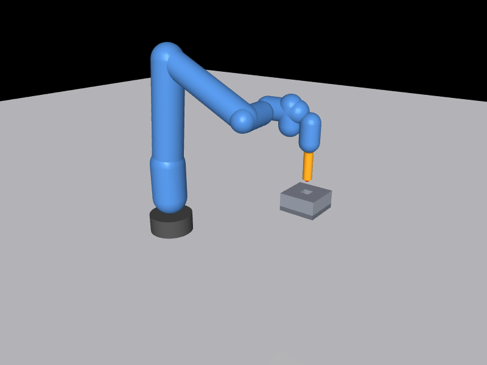
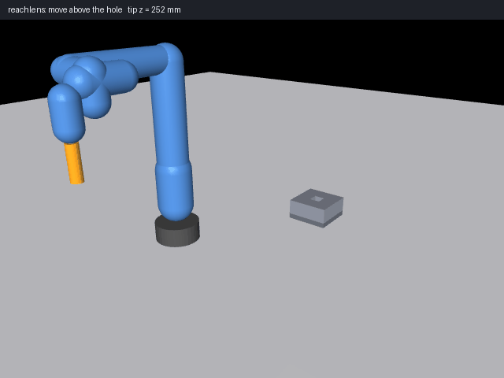

# reachlens

**Can my arm get there, and how comfortably?** Reachability and IK-success maps for robot arms, in MuJoCo. No ROS, no simulator window: it only needs the arm's MJCF.

For a grid of tool-down poses it runs damped-least-squares IK and records, per point:

- **IK success**: did a solution converge (position < 1 mm, tool axis < 0.5 deg off vertical)?
- **Manipulability**: Yoshikawa `sqrt(det(J J^T))` at the solution, low near singularities.
- **Joint-limit margin**: 0 when some joint sits on its limit, 1 when every joint is mid-range.

## Quick start

```bash
pip install git+https://github.com/darshmenon/reachlens        # numpy, mujoco, matplotlib, pillow

export REACHLENS_MODELS=~/models      # a folder holding ur3/ur3.xml or universal_robots_ur5e/ur5e.xml (see "Models")
reachlens check --arm ur3 --tool-length 0.06 --pose 0.28 0.14 0.12      # REACHABLE, exit 0 (1 if not)
reachlens map --arm ur3 --z 0.15 --jobs 4 --out reach.png               # heatmap + reach.csv, 4 processes
```

`reachlens --version` prints the version. Without a model it exits 2 and says how to point it at one.



*UR3, tool tip 0.15 m above the base plane, 60 mm peg. 45x45 poses, under a minute. The star is the peg-in-hole hole.*



*UR5e, tool at z = 0.30 m, 45x45 poses, under a minute.*

## Visuals



*`reachlens render`: the UR3 at the IK solution for the hover pose, with the 60 mm peg and the hole fixture.*



*`reachlens sweep-gif`: home, hover, descend, 1.5-turn 6 mm spiral, re-centre, insert 27 mm. Each leg is solved by IK frame by frame, so the tip path is straight. The camera eases in on the hole. The spiral is only 6 mm wide, so it is subtle at this zoom.*

[`docs/reach3d_ur3.html`](docs/reach3d_ur3.html) ([open it live](https://darshmenon.github.io/reachlens/reach3d_ur3.html)) is the interactive workspace volume (`reachlens volume`): a self-contained page, no
network or libraries. Drag to rotate, scroll to zoom, sliders pick the z range, and points are coloured by manipulability, joint-limit
margin or height. Open it in any browser. 1692 of 4375 sampled UR3 poses (7 z slices, 25x25 each, 60 mm peg) were reachable.

## Install and use

```bash
pip install .               # or: pip install git+https://github.com/darshmenon/reachlens   (-e for development)

reachlens map --arm ur3 --z 0.25 --out reach.png            # reach.png + reach.csv
reachlens map --arm ur5e --z 0.3 --half 1.0 -n 61 --jobs 4 --out ur5e.png     # --jobs: see "Speed"
reachlens map --arm ur3 --z 0.15 --tool-length 0.06 --mark 0.28 0.14 hole --out hole.png
reachlens check --arm ur3 --pose 0.28 0.14 0.15 --tool-length 0.06   # exit 0 reachable, 1 not

reachlens volume --arm ur3 --tool-length 0.06 --out reach3d.html     # interactive 3D page (about 4 min on a busy machine)
reachlens render --arm ur3 --tool-length 0.06 --pose 0.28 0.14 0.15 --hole 0.28 0.14 0.12 --out pose.png
reachlens sweep-gif --arm ur3 --out sweep.gif                        # peg-in-hole approach, defaults to the UR3 example hole
```

## Models

Models are not bundled. They are looked up in this order:

1. `--xml PATH`
2. `$REACHLENS_UR3_XML` / `$REACHLENS_UR5E_XML`
3. every folder in `$REACHLENS_MODELS` (separate several with `:`), trying `ur3.xml`, `ur3/ur3.xml`, `models/ur3/ur3.xml`,
   `universal_robots_ur5e/ur5e.xml`, `mujoco_menagerie/universal_robots_ur5e/ur5e.xml` and similar under each
4. the usual places: `~/mujoco_menagerie` (or `$MUJOCO_MENAGERIE_PATH`) for the UR5e, and
   `~/UR3_ROS2_PICK_AND_PLACE/ur_rl_training/models/ur3/ur3.xml` for the UR3

The UR3 model is in [UR3_ROS2_PICK_AND_PLACE](https://github.com/darshmenon/UR3_ROS2_PICK_AND_PLACE) and the UR5e in
[mujoco_menagerie](https://github.com/google-deepmind/mujoco_menagerie). Any 6-joint arm MJCF with a tool site works through
`--xml` and `--site`.

## Speed

A 31x31 map (961 IK problems) on a busy 22-core machine (load average 8 to 11, so treat the times as rough):

| | 0.2.0 | 0.3.0, `--jobs 1` | `--jobs 4` | `--jobs 8` |
|---|---|---|---|---|
| UR3, z = 0.15 m, 60 mm peg | 20.0 s | 7.2 s | 2.1 s | 1.4 s |
| UR5e, z = 0.30 m | 24.8 s | 6.4 to 8.4 s | 2.9 s | 2.1 s |

- The single-process speed-up is one change: the orientation error used three `np.cross` calls per IK iteration, which was about
  60% of the run time. The 0.3.0 result with `--jobs 1` is bit-identical to 0.2.0 (every column of every row, checked on both arms).
- `--jobs N` solves rows in separate processes, each row starting fresh. The result does not depend on N (4 and 8 gave the same
  numbers), and the reachable mask was the same as `--jobs 1`. But the single chain carries one row's solution into the next, so
  some points land on a different arm configuration: on the UR3 grid above, 21 of 636 reachable points differ in joint-limit margin
  (by up to 0.17) and 37 in manipulability (by at most 4e-5). That is why `--jobs 1` stays the default.
- `volume` and the `sweep-gif` solver use the single chain and have no `--jobs` yet.

```python
from reachlens import load_arm, solve_pose
model, data, site, q_home = load_arm("ur3")
r = solve_pose(model, data, site, (0.28, 0.14, 0.15), tool_length=0.06, seeds=[q_home])
r.reachable, r.manipulability, r.limit_margin, r.q
```

The CSV has `x, y, z, reachable, pos_err_m, ori_err_deg, manipulability, cond, limit_margin, iters` for every grid point.

## Example: is the UR3 peg-in-hole reachable?

`examples/peg_in_hole_ur3.py` loads the UR3 model and the hole constants from the UR3 pick-and-place repo (hole top face at
(0.28, 0.14, 0.12) in the base frame, 60 mm peg, hover 30 mm above, spiral search up to 6 mm) and checks every pose the
task visits:

```
ok  hover (30 mm above the hole)       tip=(0.280,0.140,0.150)  manip=0.0139  margin=0.37  err=0.02 mm
ok  hole top face                      tip=(0.280,0.140,0.120)  manip=0.0133  margin=0.34  err=0.02 mm
ok  fully inserted (28 mm deep)        tip=(0.280,0.140,0.092)  manip=0.0129  margin=0.32  err=0.04 mm
ok  spiral edge   0 deg (r=6 mm)  ...  (all 8 spiral points reachable, margin 0.36-0.37)
FK of the Gazebo HOVER_Q -> peg tip [0.28, 0.14, 0.15], hover target [0.28, 0.14, 0.15], distance 0.0 mm
RESULT: all reachable
```

The hole sits in a comfortable part of the workspace (margin about 0.35) but in a low-manipulability ring (about 0.014 against
0.02 at the best radius).
The last line is a real cross-check: forward kinematics of the joint vector that the Gazebo recorder uses for its hover pose
puts the peg tip on the hover target, so the MuJoCo and Gazebo setups agree. (In Gazebo the hole is at z = 1.135 because the
URDF root frame includes the 1.015 m table.)

## How it works

- **IK**: 6-D error (position plus orientation), damped least squares `dq = J^T (J J^T + l^2 I)^-1 e`, step clipping, joint
  limits clamped, early stop when the error stalls. Seeds: the previous point's solution, the model's home keyframe, then random
  restarts when both fail.
- **Early out**: a target farther from the shoulder than the sum of link offsets cannot be reached, so IK is skipped (this is
  what makes the empty corners of a map free).
- **Best of two**: in a map each point is solved from the previous solution and from the home pose, and the solution with the
  better joint-limit margin is kept, so the picture does not depend on the sweep order.
- **Wrapping**: solutions are shifted by multiples of 2 pi toward zero within the limits (UR joints span +-2 pi), otherwise the
  margin would be meaningless.

## Rendering notes

`render` and `sweep-gif` draw offscreen with MuJoCo, trying EGL then OSMesa (set `MUJOCO_GL` to force one). Here EGL failed and OSMesa
worked, so the images are software-rendered. The UR3 model has capsule collision geometry only (no meshes), so the arm is drawn as
capsules (their group is switched on and recoloured blue). The peg, hole fixture and trail are drawn on top of the scene; the fixture is
a visual stand-in at the hole position, not part of the model.

## Limits

- **Kinematic reach only.** No collisions, no table, no self-collision, no payload, no dynamics. A reachable pose can still be
  blocked in a real cell.
- **One solution per point.** The map shows the best of a few IK solutions, not every arm configuration. Visible straight
  boundaries in the manipulability panel (for example the small patch right of the UR3 base) are where the chosen configuration
  changes. A point marked unreachable means the seeds did not converge, which is almost always, but not provably, out of reach.
- **Tool-down only.** The tool axis points straight down, with a fixed yaw (`--yaw`). Tilted tools are not mapped yet.
- Margin is measured against the MJCF limits, which for the UR models are +-2 pi (+-pi for the elbow); tighten them in your
  MJCF if your cell is more restrictive.

## Tests

```bash
pip install -e .[test] && pytest        # 13 tests, about 4 s; model-dependent ones skip when the MJCF is missing
```
